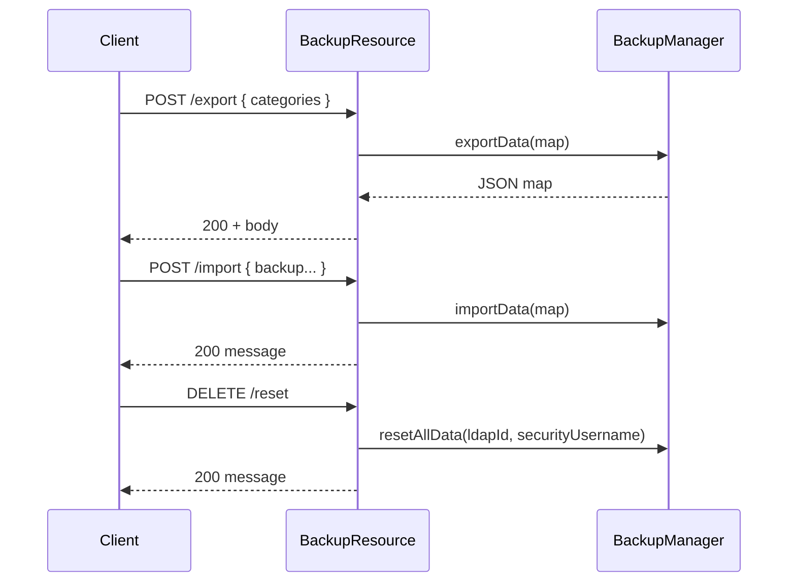

# Backup — HTTP endpoints

Base path: **`/api/v2/backup`**.

All routes require **admin authentication** (`@AdminOnly`).

Common headers (same as the rest of Dashboard admin calls):

- Bearer token for Keycloak where applicable (`Authorization: Bearer …`).
- For dashboard **SecurityAdmin** JWT: cookie `ADMIN_TOKEN` and/or header `admin-token` (see `AdminFilter` / `BackupResource`).

---

## Export

### `POST /api/v2/backup/export`

**Purpose:** Build a JSON backup containing only the categories you request.

**Content-Type:** `application/json`.

**Body:** JSON object — category key → `true` / `false` (only keys with `true` are exported).

Each key below is optional; export includes a top-level block only if its value is `true`.

| Key | Exported top-level key in JSON |
|-----|--------------------------------|
| `generalData` | `generalData` |
| `schedule` | `schedule` |
| `styling` | `styling` |
| `ticketDesigns` | `ticketDesigns` |
| `customers` | `customers` |
| `orders` | `orders` |
| `products` | `products` |
| `maturants` | `maturants` |
| `tableLayout` | `tableLayout` |
| `settings` | `settings` |

**Response:** `200` — JSON object. Always includes `version` (number, currently `1`), `exportDate` (ISO-8601 string), plus any selected category blocks as above.

**Errors:** `500` — JSON `{ "error": "Export failed: …" }`.

---

## Import

### `POST /api/v2/backup/import`

**Purpose:** Apply data from a previously exported (or compatible) JSON file.

**Content-Type:** `application/json`.

**Body:** Single JSON object — same shape as export (only present keys are processed).

If a key is **missing**, that part of the database is left unchanged. Recognised top-level keys:

| Key | Typical merge behaviour |
|-----|-------------------------|
| `generalData` | Overwrites singleton `Data` (id 1) |
| `schedule` | Replaces all schedule entries |
| `styling` | Overwrites singleton `Style` (id 1) |
| `ticketDesigns` | **Appends** new designs (does not delete existing) |
| `customers` | **Appends** |
| `orders` | **Appends** (new customers nested in orders) |
| `products` | **Appends** |
| `maturants` | **Appends** (skips duplicate `ldapUser`) |
| `tableLayout` | **Replaces** layout (delete then recreate layers → rooms → tables → seats) |
| `settings` | Upserts numeric `Setting` rows by `key` |

**Response:** `200` — `{ "message": "Import completed successfully" }`.

**Errors:** `500` — `{ "error": "Import failed: …" }`.

---

## Reset

### `DELETE /api/v2/backup/reset`

**Purpose:** Yearly “full wipe”: orders, customers, designs, layout, shop data, most users, etc.

**Body:** None.

**Caller identity:** Taken from `SecurityContext` and/or JWT cookie/header (see implementation doc).

**Response:** `200` — `{ "message": "All transactional data has been reset" }`.

**Errors:** `500` — `{ "error": "Reset failed: …" }`.

---

## Diagram

