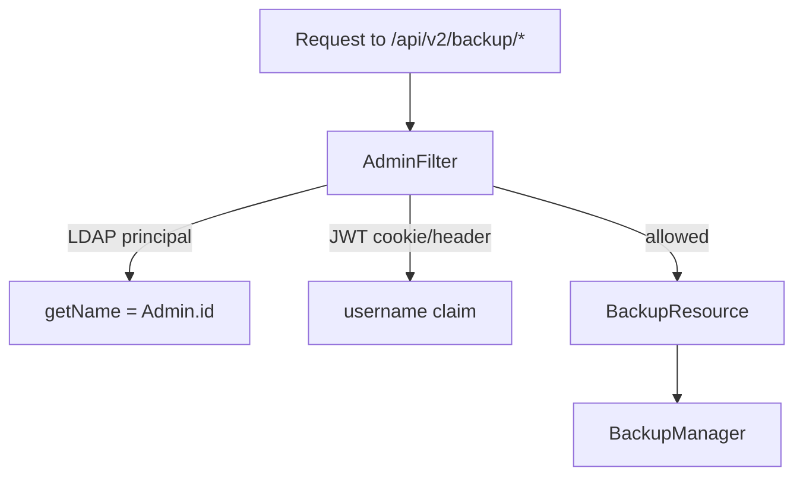

# Backup / reset – implementation notes

Oriented for developers changing server or Dashboard behaviour.

## Main files

| Area | Path |
|------|------|
| REST API | `apps/Server/service/.../api/BackupResource.java` |
| Business logic | `apps/Server/logic/.../BackupManager.java` |
| Dashboard UI | `apps/Client/Dashboard/src/pages/settings/backup.tsx` |
| Route | `apps/Client/Dashboard/src/App.tsx` → `/settings/backup` |
| Nav link | `apps/Client/Dashboard/src/components/global/nav.tsx` |

## `BackupResource`

- Class: `@Path("/api/v2/backup")`, constructor injection of `BackupManager`, `JWTParser`.
- **export** – forwards `Map<String, Boolean>` to `exportData`.
- **import** – forwards full JSON `Map<String, Object>` to `importData` inside a transaction.
- **reset** – computes who to keep, then calls `resetAllData(ldapAdminIdToKeep, securityAdminUsernameToKeep)`:
  - **LDAP / OIDC:** `SecurityContext.getUserPrincipal().getName()` → must match `Admin.id` to preserve that `Admin` row.
  - **SecurityAdmin JWT:** token from cookie `ADMIN_TOKEN` or header `admin-token`; claim `username` → preserve matching `SecurityAdmin` row.
  - If no matching row, that table is fully cleared (except the other table may still be partially preserved).

## `BackupManager` (summary)

### Export (`exportData`)

- `@Transactional` so lazy collections / LOBs are safe during serialization.
- `generalData` copies `Data` singleton and eagerly copies `images` list to avoid lazy errors.
- `settings` exports only entities in `Setting` (numeric key/value). **`StringSetting` (API keys, etc.) is not exported.**

### Import (`importData`)

- `@Transactional`; processes only keys present in the JSON.
- **Table layout:** clears seats → tables → rooms → layers, then inserts from JSON (full replace).
- **Ticket designs:** new rows only (append).
- **Orders / customers / products:** append-style inserts.
- **Settings:** upsert by string `key`; values coerced to numeric `Setting.value`.

### Reset (`resetAllData`)

Rough order (see source for exact JPQL):

1. Detach seats from orders, delete order-related entities, customers, caches, printed IDs, `UserAccount`, then selective **Admin** / **SecurityAdmin** purge (see above), maturants, students, graduates.
2. Delete products, design elements/pages/designs, seat plan.
3. Clear singleton `Data` and `Style` text fields to defaults / empty.
4. **`Phase`:** always set to `0` (create `Setting` row if missing). **`BoughtTicketCount`:** set to `0` if row exists.
5. Does **not** delete arbitrary `StringSetting` rows (secrets stay unless you add that elsewhere).

## UI (`backup.tsx`)

- Export: builds checkbox map → `POST api/v2/backup/export` with JSON body → downloads blob as `backup-<date>.json`.
- Import: file → `JSON.parse` → confirmation dialog → `POST api/v2/backup/import`.
- Reset: random code drawn on canvas (hard to copy-paste) → confirm `AlertDialog` → `DELETE api/v2/backup/reset`.

## Auth filter interaction

For **reset**, preserving the operator requires `BackupResource` to pass through principal / parsed JWT username into `resetAllData`; import/export do not need those parameters.
