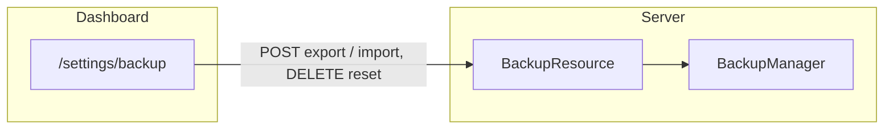

# Backup, import & yearly reset

This project can **export** selected data as JSON, **import** a backup file, and **reset** almost all database content for a new school year. All of this is **admin-only**.

## Where to read next

| Document | Purpose |
|----------|---------|
| [Recovery-Reset.endpoints.md](./Recovery-Reset.endpoints.md) | REST paths, methods, bodies, responses |
| [Recovery-Reset.implementation.md](./Recovery-Reset.implementation.md) | Server classes, behaviour rules, UI entry point |

## High-level flow

- **Export**: choose categories → JSON file download (includes `version` and `exportDate`).
- **Import**: upload JSON → server merges data (overwrite vs append depends on section; see implementation doc).
- **Reset**: destructive wipe with UI verification; server keeps the acting admin and numeric `Phase` is forced to `0`.

## Sensitive data

Numeric `Setting` rows can appear in export/import. **String secrets** (e.g. Stripe keys in `StringSetting`) are **not** part of this backup JSON and are **not** cleared by reset logic that only touches selected entities (see implementation doc for what reset deletes).
