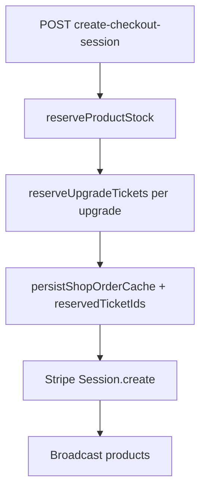

# Shop — implementation notes

Code map:

- `apps/Server/service/src/main/java/at/htlleonding/api/ShopResource.java` — REST API
- `apps/Server/logic/src/main/java/at/htlleonding/ProductManager.java` — stock, orders, upgrades, Stripe-related reserve/fulfill
- `apps/Server/interface/.../ShopCheckoutRequestDTO.java` — cart JSON in `OrderCache`
- `apps/Server/service/src/main/java/at/htlleonding/WebSockets/ShopStockWebSocket.java` — live product list

---

## Stripe keys

`ShopResource` uses the **same** rule as ticket checkout:

- `getEffectiveStripeKey()` → DB `StripeSecretKey` if set, else `config.stripe-secret-key`.

Stripe enable flag: **`SettingManager.isStripeEnabled()`** (same as Order app).

---

## Checkout session flow (high level)

1. **Reserve stock** — pessimistic locks on products; decrements stock; conflicts → `409`.  
2. **Reserve upgrades** — locks eligible digital tickets, marks as physical for hold; on failure, **restores product stock**.  
3. **Persist `OrderCache`** — JSON is `ShopCheckoutRequestDTO` including **`reservedTicketIds`**. On failure, restore stock + tickets.  
4. **Stripe** — line items from product prices + upgrade line items (price from `TicketManager.getAdditionalChargeForPhysicalTicket()`). Metadata: `order_cache_id`, **`source=shop`**. Session **expires** in ~30 minutes.  
5. On Stripe error after reservations: **restore** stock and upgrade ticket holds.

---

## After payment (webhook)

Production: Stripe should call **`POST /api/v2/checkout/webhook`** (see [Stripe.endpoints.md](./Stripe.endpoints.md)). When `metadata.source == shop"`:

- **`checkout.session.completed`** / **`async_payment_succeeded`** with `payment_status == paid` → `ProductManager.fulfillPaidShopOrder(cart)` (creates product orders / upgrade records from already-reserved state).  
- **`checkout.session.expired`** → `ProductManager.undoShopReservation(cart)`.

`ShopResource.shopWebhook` duplicates similar logic for **`POST /api/v2/shop/webhook`** if you configure that URL in Stripe instead.

---

## Reserve-only mode (Stripe off)

When Stripe is disabled, the Shop UI uses **`POST /api/v2/shop/bulk-order`** and **`POST /api/v2/shop/upgrade-by-type`** instead of `create-checkout-session` (no Stripe session).

---

## Frontend

- **Shop app:** `apps/Client/Shop/` — calls `/api/v2/checkout/stripe-enabled` for parity with Order, then shop endpoints under `/api/v2/shop/...`.  
- **Env:** `VITE_API_Q_URL` (or project-specific base) should point at the Quarkus server.

---

## Docker / URLs

`config.shop-url` is fed by **`SHOP_URL`** in compose for success/cancel redirects. Align this with the URL users open in the browser.
