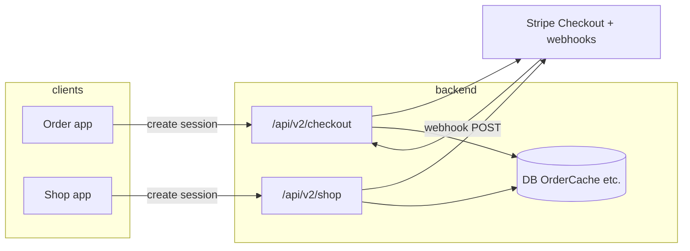

# Stripe and Shop — overview

This project uses **Stripe Checkout** (hosted payment page) for:

1. **Ticket orders** (Angular Order app) — ball tickets and optional table seats.  
2. **Merchandise shop** (React Shop app) — products and ticket upgrades.

Both flows store a snapshot of the cart in **`OrderCache`** and put `order_cache_id` in the Stripe session **metadata**. After payment, a **webhook** loads that cache and completes the order.

## Where to read more

| Topic | File |
|--------|------|
| Ticket / checkout HTTP API and webhook | [Stripe.endpoints.md](./Stripe.endpoints.md) |
| How ticket Stripe flow is built in code | [Stripe.implementation.md](./Stripe.implementation.md) |
| Shop HTTP API | [Shop.endpoints.md](./Shop.endpoints.md) |
| How shop Stripe and products are built | [Shop.implementations.md](./Shop.implementations.md) |

## One diagram: who talks to whom

**Important:** Configure the Stripe Dashboard webhook endpoint to the URL your deployment exposes for **`POST /api/v2/checkout/webhook`**. That handler reads `metadata.source` and routes **shop** vs **ticket** orders. There is also `POST /api/v2/shop/webhook` in code; production setups normally use a **single** webhook URL pointing at checkout (see [Stripe.endpoints.md](./Stripe.endpoints.md)).

## Keys and toggles (short)

- **Stripe on/off** and **keys** can live in the **database** (via admin API / `SettingManager`).  
- **Fallback** secret key and webhook secret come from **`application.properties`** / env (`STRIPE_SECRET_KEY`, `STRIPE_WEBHOOK_SECRET`).  
- Runtime rule: **use DB value if set, else config.**

Details: [Stripe.implementation.md](./Stripe.implementation.md).
