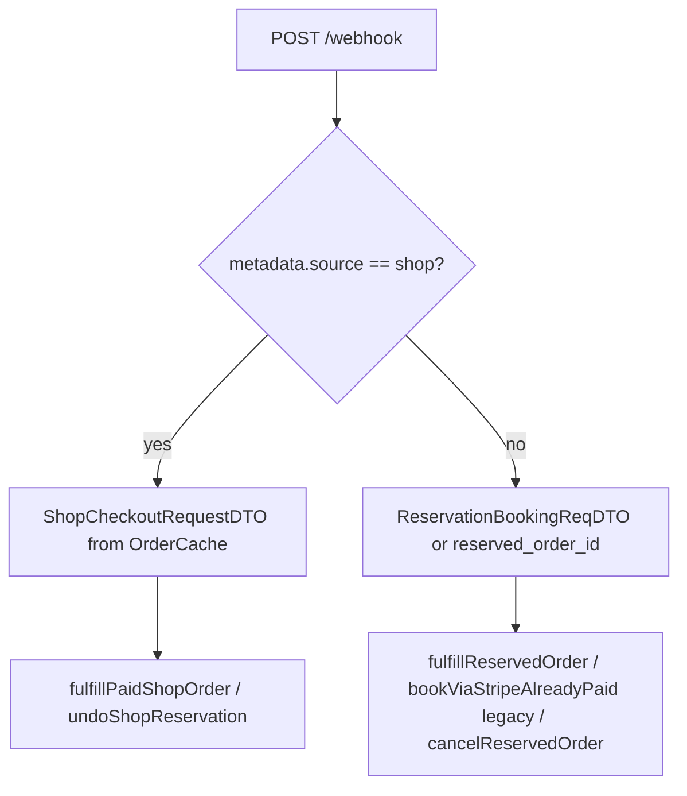

# Stripe — HTTP endpoints and webhooks

Base path for the ticket / shared checkout API: **`/api/v2/checkout`**.

Unless noted, bodies are **JSON** (`Content-Type: application/json`).

---

## `GET /api/v2/checkout/stripe-enabled`

**Purpose:** Check whether Stripe payments are allowed (for Order and Shop UIs).

**Auth:** Public (`@PermitAll`).

**Response:** `200` JSON

```json
{ "enabled": true }
```

---

## `POST /api/v2/checkout/create-checkout-session`

**Purpose:** Start Stripe Checkout for a **ticket reservation** (Order app). Creates a provisional order, caches the reservation JSON, returns the Stripe Checkout URL.

**Auth:** Public; `@PhaseApproved` (sales phase must allow booking).

**Headers:** Standard JSON.

**Body:** `ReservationBookingReqDTO`

| Field | Type | Notes |
|--------|------|--------|
| `customer` | object | `CustomerDTO` — name, email, address, etc. |
| `tickets` | array | `TicketBookingEndpointDto` — type, physical flag, … |
| `seats` | array or null | `Seat` entities as sent by the client (id, price, geometry). Used for locking + Stripe line items. |
| `token` | string | Optional non-student access token (same as non-Stripe book flow). |

**Success:** `200` JSON

```json
{ "location": "https://checkout.stripe.com/..." }
```

**Errors (examples):**

| Status | When |
|--------|------|
| `403` | Stripe disabled in settings |
| `409` | Not enough tickets or seat no longer free — JSON `{ "message": "..." }` |
| `400` | Missing / invalid reservation data |
| `500` | Order cache or Stripe API failure (reserved order is rolled back where applicable) |

**Stripe session metadata (set by server):**

| Key | Meaning |
|-----|---------|
| `order_cache_id` | UUID of `OrderCache` row (reservation JSON) |
| `reserved_order_id` | UUID of provisional `Order` (WAITING) — used on payment / expiry |

Session expiry is set server-side (about **30 minutes**).

---

## `POST /api/v2/checkout/webhook`

**Purpose:** Stripe sends checkout events here (when this URL is configured in Stripe). Completes ticket orders, shop orders, or releases reservations on expiry.

**Auth:** Public (Stripe calls it). **Note:** This handler expects your app’s **`StripeWebhookDTO`** JSON shape (see `StripeWebhookDTO` / `StripeEventDTO` in the server). Stripe’s raw signed payload verification is not documented in this file; align your integration with how the server parses the body.

**Body:** Webhook wrapper, roughly:

| Field | Meaning |
|-------|---------|
| `type` | Event type string, e.g. `checkout.session.completed` |
| `data.object` | Checkout session fields used below |

**Session object fields used:**

| Field | Meaning |
|-------|---------|
| `metadata.order_cache_id` | **Required** — links to `OrderCache` |
| `metadata.source` | `"shop"` for shop carts; empty/absent for ticket orders |
| `metadata.reserved_order_id` | Ticket flow: provisional order UUID |
| `payment_status` | Must be `"paid"` for fulfillment on success events |

**Handled `type` values (high level):**

| Event | Behaviour |
|-------|-----------|
| `checkout.session.expired` | Shop: undo product/upgrade reservation. Ticket: cancel provisional order + release seats if `reserved_order_id` present. |
| `checkout.session.completed` | If `paid`: fulfill shop or ticket order (or legacy ticket path without `reserved_order_id`). |
| `checkout.session.async_payment_succeeded` | Same success branch as completed (async payment methods). |
| Other | Usually `200` with “ignoring” style message |

**Routing:**



---

## `GET /api/v2/checkout/session/{sessionId}`

**Purpose:** After redirect from Stripe, the Order app loads session + cached reservation for the success page.

**Path parameter:**

| Param | Type | Meaning |
|-------|------|---------|
| `sessionId` | string | Stripe Checkout Session id |

**Response:** `200` JSON — `customer`, `tickets`, `seats`, `paymentStatus`, `amountTotal`, `currency` (from cache + Stripe session).

**Errors:** `400` invalid session, `404` missing metadata / cache.

---

## Admin — Stripe toggle and keys (same Stripe backend, different path)

**Base:** `/api/v2/admin` — **admin JWT required** (`@AdminOnly`).

| Method | Path | Body / query | Purpose |
|--------|------|--------------|---------|
| `GET` | `/stripe-enabled` | — | `{ "enabled": boolean }` |
| `POST` | `/stripe-enabled` | JSON `{ "enabled": true }` | Turn Stripe on/off (only in **phase 0** in code) |
| `GET` | `/stripe-keys` | — | `{ "secretKey": "", "webhookSecret": "" }` (values from DB) |
| `POST` | `/stripe-keys` | JSON `{ "secretKey": "...", "webhookSecret": "..." }` | Save keys (only phase 0); omit or blank to skip updating a field |

See [Stripe.implementation.md](./Stripe.implementation.md) for where these are stored.
