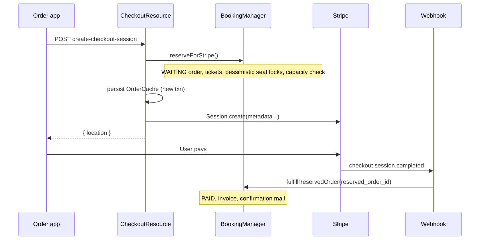

# Stripe — implementation notes (tickets / checkout resource)

Keep this file aligned with:

- `apps/Server/service/src/main/java/at/htlleonding/api/CheckoutResource.java`
- `apps/Server/logic/src/main/java/at/htlleonding/BookingManager.java`
- `apps/Server/logic/src/main/java/at/htlleonding/SettingManager.java`

---

## Configuration (keys and URLs)

### Environment / `application.properties`

| Property | Env override (typical) | Role |
|----------|-------------------------|------|
| `config.stripe-secret-key` | `STRIPE_SECRET_KEY` | Fallback Stripe **secret** API key |
| `config.stripe-webhook-secret` | `STRIPE_WEBHOOK_SECRET` | Fallback webhook signing secret (if you verify signatures elsewhere) |
| `config.order-url` | `ORDER_URL` | Success/cancel redirect base for **Order** app |
| `config.shop-url` | `SHOP_URL` | Used by shop session URLs (see shop docs) |
| `config.web-url` | `WEB_URL` | Public web base URL |

At runtime, **`CheckoutResource.getEffectiveStripeKey()`** uses:

1. DB value from `SettingManager.getStripeSecretKey()` if non-blank  
2. Else `config.stripe-secret-key`

Same pattern exists for webhook secret helper (`getEffectiveWebhookSecret()`), used when you wire signature verification.

### Database (preferred in production)

`SettingManager` persists:

| Logical key | Storage | Purpose |
|-------------|---------|---------|
| `StripeEnabled` | `Setting` table (numeric 0/1) | Master switch |
| `StripeSecretKey` | `StringSetting` table | Secret key |
| `StripeWebhookSecret` | `StringSetting` table | Webhook secret |

Admin REST: **`/api/v2/admin/stripe-enabled`** and **`/api/v2/admin/stripe-keys`** (see [Stripe.endpoints.md](./Stripe.endpoints.md)).

---

## OrderCache

`OrderCache` holds the **JSON snapshot** of the reservation (`ReservationBookingReqDTO.toJson()`).

Stripe metadata **`order_cache_id`** points to this row so the webhook can reload the exact cart after payment.

---

## Reserve → pay → fulfill (ticket flow)

- **`reserveForStripe`**: creates customer + **WAITING** order + tickets; locks **`MaxTicketCount`** row and each **Seat** row to avoid races.  
- **`fulfillReservedOrder`**: sets **PAID**, invoice number, sends payment confirmation.  
- **`cancelReservedOrder`**: on Stripe failure or **session expired** — **CANCELLED**, seats released.

Legacy sessions **without** `reserved_order_id` still call **`bookViaStripeAlreadyPaid`** from the webhook (old behaviour).

---

## Stripe line items (ticket session)

Built in `CheckoutResource`: aggregated counts for student/external × digital/physical using `TicketManager` prices, plus **seat** line items grouped by **seat price** (label `Sitzplatz`).

---

## Shop overlap

Shop checkout **also** ends up in `CheckoutResource` webhook when Stripe is configured to post there: metadata **`source=shop`** switches to `ProductManager` (see [Shop.implementations.md](./Shop.implementations.md)).

`ShopResource` defines an alternate **`/api/v2/shop/webhook`**; if you use only one webhook URL in Stripe, point it at **`/api/v2/checkout/webhook`** unless you intentionally duplicate handling.
